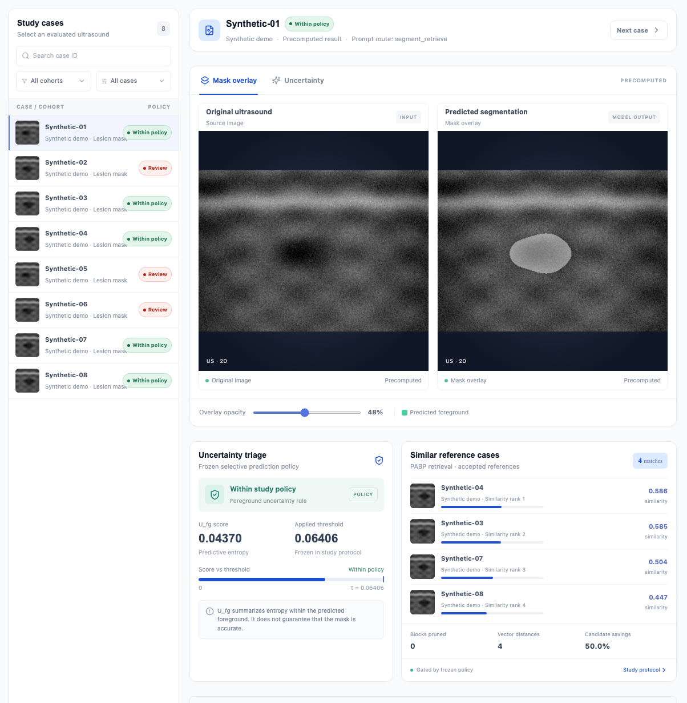

# MedCLIPSeg++: Towards More Reliable Medical Image Segmentation

**Uncertainty-guided review for breast ultrasound segmentation, with retrieval of similar reference cases.**

[Interactive walkthrough](docs/learning/LEARNING_GUIDE.md) · [Research and evidence](research/RESEARCH_GUIDE.md) · [Notebooks](#notebooks) · [Run the dashboard](#run-the-complete-system) · [Sources](ATTRIBUTION.md)

## System architecture


[Open full-size SVG](docs/architecture/figures/block_diagram/complete_system_architecture.svg) · [Editable diagram](docs/architecture/figures/block_diagram/complete_system_architecture.drawio) · [Architecture guide](docs/architecture/SYSTEM_ARCHITECTURE.md) · [Application stages](application/stages/APPLICATION_STAGES.md) · [Study stages](research/RESEARCH_GUIDE.md#explore-the-six-stages)

## Overview

A segmentation model can produce a plausible outline even when the prediction is poor. MedCLIPSeg++ studies whether a frozen MedCLIPSeg model's pixelwise uncertainty map can help decide which breast ultrasound segmentations to retain and which to flag for review. It compares seven ways of reducing the map to one score per scan, selects a rule on BUSI validation, and tests the same rule on a separate BUSI split and four external cohorts.

The system also includes a local dashboard that shows precomputed segmentations and retrieves similar cases. **Stage 4, the uncertainty-based review decision, is the experimentally evaluated contribution.** The wider application shows how that decision can sit between segmentation and retrieval.

## Method

1. **Predict the mask and uncertainty.** A frozen MedCLIPSeg model produces a lesion mask and a predictive entropy map, which measures ambiguity at each pixel.
2. **Summarize uncertainty per scan.** For a nonempty prediction, the selected score averages entropy inside the predicted mask. This reduces the influence of background pixels on small lesions. An empty prediction uses a separate whole-image uncertainty rule.
3. **Choose an operating point on validation.** The study compares seven scores on the same BUSI validation images. The selected threshold retained 52 of 65 lesion cases in validation and was carried forward to the test cohorts.
4. **Use the decision downstream.** In the dashboard, a retrieval request returns similar eligible reference cases when the matched query passes the uncertainty rule. Similarity uses visual embeddings with FAISS and Predicate-Aware Block Pruning (PABP).

See the [experimental rationale](research/stage_4_selective_prediction/study_reference/EXPERIMENTAL_RATIONALE.md) for the cohort, hardware, image-processing and statistical choices. The [system design rationale](docs/architecture/DESIGN_RATIONALE.md) explains the application and search index.

## Results

On BUSI validation, foreground mean entropy had the lowest area under the risk–coverage curve (AURC) for Dice loss among the seven candidates, at **0.0839**. Whole-image mean entropy scored **0.1438**. Foreground entropy standard deviation was close at **0.0850**, with a paired confidence interval that included zero. Lower AURC means the score tends to retain lower-loss cases over a range of coverage levels. [Validation results](research/stage_4_selective_prediction/experiments/RESULTS_GUIDE.md).

| Test cohort | Retained at the frozen threshold | Mean Dice, all lesion cases in the analysis | Mean Dice, retained cases |
| --- | ---: | ---: | ---: |
| BUSI | 47/65 (72.3%) | 0.8286 | 0.9031 |
| UDIAT | 14/25 (56.0%) | 0.7467 | 0.8747 |
| BUID | 20/35 (57.1%) | 0.7900 | 0.8818 |
| BUSUC | 78/122 (63.9%) | 0.8430 | 0.8982 |
| BUSBRA | 126/282 (44.7%) | 0.7511 | 0.8536 |
| **External cohorts pooled** | **238/464 (51.3%)** | **0.7780** | **0.8718** |

Dice measures overlap with the reference annotation. These gains describe the retained subset. The rule leaves each predicted mask as produced by the backbone. The external results also show the cost of using a fixed threshold, with roughly half of cases sent to review. One poor BUSI segmentation passed the rule. The experiments used the upstream prompt workflow, whose available descriptions include diagnostic terms. [Full results and limitations](research/stage_4_selective_prediction/experiments/RESULTS_GUIDE.md) · [Cross-domain data](research/stage_4_selective_prediction/experiments/external_test/results/cross_domain_summary.csv).

## Get the project

Clone the repository once for the study scripts, notebooks and dashboard.

```bash
git clone https://github.com/Fergarciamedina/MedCLIPSeg-plus-plus.git
cd MedCLIPSeg-plus-plus
```

## Reproduce the research

**Inspect the published results.** The benchmarking notebook reads bundled aggregate tables and redraws the comparisons. It needs Python, Jupyter and scientific plotting packages. The included results can be inspected without acquiring data or model weights. [Notebook requirements](research/notebooks/NOTEBOOK_GUIDE.md#scientific-benchmarking-notebook).

**Rerun validation and testing from saved scores.** Supply the six per-image score tables from the prepared splits. The study launcher recalculates the validation selection, held-out BUSI results and cross-cohort results. [Expected files and commands](research/stage_4_selective_prediction/SELECTIVE_PREDICTION_STUDY.md#reproduction).

**Regenerate the predictions as well.** Use Python and Bash, install [the research requirements](requirements.txt), and obtain the prepared BUSI, UDIAT, BUID, BUSUC and BUSBRA images, reference masks and prompt workbooks. Use the released BUSI MedCLIPSeg checkpoint for seed 666 and select CPU, Apple MPS or CUDA as available. The original inference used Apple Silicon. [Data and checkpoint setup](research/stage_4_selective_prediction/SELECTIVE_PREDICTION_STUDY.md#reproduction) · [Cohort checks](research/stage_1_study_inputs/STUDY_INPUTS.md).

## Run the complete system

**Requirements.** Use Python 3.9 or newer, Bash, Node.js 20 or newer with npm for the initial build, and a browser. Supply a catalog CSV, PNG or JPEG images, binary PNG masks, and either aligned NumPy entropy arrays or their foreground and whole-image scores. Supply matching 512-dimensional embeddings, or use the optional UniMedCLIP checkpoint to compute them. The web application loads these assets locally on the first gallery request. [Catalog, data types and embedding contract](application/APPLICATION_GUIDE.md#gallery-catalog).

From the repository root, install and launch with your prepared gallery.

```bash
bash application/medical_dashboard/run_local.sh --setup \
  --gallery "/path/to/gallery.csv" --embeddings "/path/to/gallery_embeddings.npz"
```

Open [the local dashboard](http://127.0.0.1:5173). Subsequent starts use the same command without `--setup`. Upload a catalog image and ask to segment it and find similar cases. The dashboard uses stored model outputs and marks unmatched uploads **Not Evaluated**. [Prepare masks and entropy](application/APPLICATION_GUIDE.md#gallery-catalog) · [Prepare embeddings](application/APPLICATION_GUIDE.md#embeddings-and-search-index).

## Notebooks

Each notebook runs inside a local clone, independently of the web dashboard.

| Notebook | What it reproduces | Inputs |
| --- | --- | --- |
| [01 · Complete system pipeline](research/notebooks/01_complete_system_pipeline.ipynb) | Runs the six software interfaces in Python with a synthetic segmentation adapter. Its example can exercise filtered lookup with demonstration data or a configured gallery. | A folder of PNG or JPEG images, with optional gallery and embeddings. [Requirements and configuration](research/notebooks/NOTEBOOK_GUIDE.md#complete-system-pipeline-notebook). |
| [02 · Scientific benchmarking](research/notebooks/02_scientific_benchmarking.ipynb) | Redraws the archived study and can invoke the same reproduction runner from saved scores or from prepared images and model weights. | Bundled aggregate tables by default. Supply local scores or the prepared cohorts, prompts and checkpoint for a rerun. [Requirements and configuration](research/notebooks/NOTEBOOK_GUIDE.md#scientific-benchmarking-notebook). |

## Repository map

| Folder | What you will find |
| --- | --- |
| [research/](research/RESEARCH_GUIDE.md) | Study inputs, the six-stage research map, Stage 4 experiments and notebooks. |
| [application/](application/APPLICATION_GUIDE.md) | Dashboard setup, runtime services and the six notebook interfaces. |
| [shared/](shared/SHARED_COMPONENTS.md) | Frozen segmentation source, dataset YAMLs and offline commands. |
| [docs/](docs/DOCUMENTATION_MAP.md) | Interactive walkthrough, dashboard preview, architecture guides and figure sources. |

## See the dashboard

[](application/medical_dashboard/DASHBOARD_GUIDE.md)

The screenshot shows the mask overlay, the review decision and similar cases in the running dashboard with synthetic images, masks and embeddings. [Run the dashboard](application/APPLICATION_GUIDE.md) · [Follow the interactive walkthrough](docs/learning/LEARNING_GUIDE.md).

## Upstream work and licensing

MedCLIPSeg++ uses MedCLIPSeg as its segmentation backbone, UniMedCLIP for visual embeddings, and PABP for eligibility-filtered search. The project guide links the source works, methodological publications and evidence for the decisions made at each stage. [Attribution and references](ATTRIBUTION.md).

[License and third-party terms](LICENSE) · [MedCLIPSeg Apache-2.0 license](shared/LICENSE-MedCLIPSeg).
