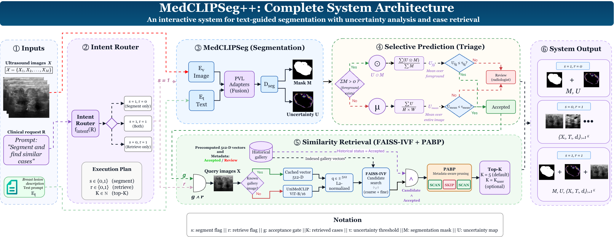

# MedCLIPSeg++: Towards More Reliable Medical Image Segmentation

**Uncertainty-guided review for breast ultrasound segmentation, with retrieval of similar reference cases.**

[Research](research/RESEARCH_GUIDE.md) · [Results](research/stage_4/experiments/RESULTS_GUIDE.md) · [Notebooks](research/RESEARCH_GUIDE.md#notebooks) · [Run the dashboard](application/APPLICATION_GUIDE.md) · [Sources and scientific basis](ATTRIBUTION.md)

## Overview

A segmentation model can produce a plausible outline even when the prediction is poor. MedCLIPSeg++ studies whether a frozen MedCLIPSeg model's pixelwise uncertainty map can help decide which breast ultrasound segmentations to retain and which to flag for review. It compares seven ways of reducing the map to one score per scan, selects a rule on BUSI validation, and tests the same rule on a separate BUSI split and four external cohorts.

The system also includes a local dashboard that shows precomputed segmentations and retrieves similar cases. **Stage 4, the uncertainty-based review decision, is the experimentally evaluated contribution.** The wider application shows how that decision can sit between segmentation and retrieval.

[Editable diagram](docs/architecture/figures/block_diagram/complete_system_architecture.drawio) · [Architecture guide](docs/architecture/SYSTEM_ARCHITECTURE.md) · [Application stages](application/stages/APPLICATION_STAGES.md) · [Study stages](research/RESEARCH_GUIDE.md#explore-the-six-stages)

## Method

1. **Predict the mask and uncertainty.** A frozen MedCLIPSeg model produces a lesion mask and a predictive entropy map, which measures ambiguity at each pixel.
2. **Summarize uncertainty per scan.** For a nonempty prediction, the selected score averages entropy inside the predicted mask. This reduces the influence of background pixels on small lesions. An empty prediction uses a separate whole-image uncertainty rule.
3. **Choose an operating point on validation.** The study compares seven scores on the same BUSI validation images. The selected threshold retained 52 of 65 lesion cases in validation and was carried forward to the test cohorts.
4. **Use the decision downstream.** In the dashboard, a retrieval request returns similar eligible reference cases when the matched query passes the uncertainty rule. Similarity uses visual embeddings with FAISS and Predicate-Aware Block Pruning (PABP).

See the [experimental rationale](research/stage_4/study_reference/EXPERIMENTAL_RATIONALE.md) for the cohort, hardware, image-processing and statistical choices. The [system design rationale](docs/architecture/DESIGN_RATIONALE.md) explains the application and search index.

## Results

On BUSI validation, foreground mean entropy had the lowest area under the risk–coverage curve (AURC) for Dice loss among the seven candidates, at **0.0839**. Whole-image mean entropy scored **0.1438**. Foreground entropy standard deviation was close at **0.0850**, with a paired confidence interval that included zero. Lower AURC means the score tends to retain lower-loss cases over a range of coverage levels. [Validation results](research/stage_4/experiments/RESULTS_GUIDE.md).

| Test cohort | Retained at the frozen threshold | Mean Dice, all lesion cases in the analysis | Mean Dice, retained cases |
| --- | ---: | ---: | ---: |
| BUSI | 47/65 (72.3%) | 0.8286 | 0.9031 |
| UDIAT | 14/25 (56.0%) | 0.7467 | 0.8747 |
| BUID | 20/35 (57.1%) | 0.7900 | 0.8818 |
| BUSUC | 78/122 (63.9%) | 0.8430 | 0.8982 |
| BUSBRA | 126/282 (44.7%) | 0.7511 | 0.8536 |
| **External cohorts pooled** | **238/464 (51.3%)** | **0.7780** | **0.8718** |

Dice measures overlap with the reference annotation. These gains describe the retained subset. The rule leaves each predicted mask as produced by the backbone. The external results also show the cost of using a fixed threshold, with roughly half of cases sent to review. One poor BUSI segmentation passed the rule. The experiments used the upstream prompt workflow, whose available descriptions include diagnostic terms. [Full results and limitations](research/stage_4/experiments/RESULTS_GUIDE.md) · [Cross-domain data](research/stage_4/experiments/external_test/results/cross_domain_summary.csv).

## Run or reproduce

| I want to… | Start here |
| --- | --- |
| Inspect the experiment without datasets or model weights | Open the [result tables](research/stage_4/experiments/RESULTS_GUIDE.md) or run the [benchmarking notebook](research/notebooks/02_scientific_benchmarking.ipynb) using the bundled aggregate results. |
| Understand the complete pipeline | Read the [six-stage guide](research/RESEARCH_GUIDE.md) or run the [software walkthrough](research/notebooks/01_complete_system_pipeline.ipynb) with the synthetic segmentation adapter. |
| Run the dashboard with my own cases | Follow the [application setup](application/APPLICATION_GUIDE.md) to supply a CSV catalog, images, masks, uncertainty artifacts and either precomputed or locally generated embeddings. Uploads without matching stored outputs are marked **Not Evaluated**. |
| Regenerate the study from prepared data and weights | Follow the [Stage 4 reproduction commands](research/stage_4/SELECTIVE_PREDICTION_STUDY.md#reproduction) and [model configuration guide](shared/configs/DATASET_CONFIGURATIONS.md). |

## Repository map

| Folder | What you will find |
| --- | --- |
| [research/](research/RESEARCH_GUIDE.md) | Study inputs, the six-stage research map, Stage 4 experiments and notebooks. |
| [application/](application/APPLICATION_GUIDE.md) | Dashboard setup, runtime services and the six notebook interfaces. |
| [shared/](shared/SHARED_COMPONENTS.md) | Frozen segmentation source, dataset YAMLs and offline commands. |
| [docs/](docs/DOCUMENTATION_MAP.md) | Architecture guides and the figure sources and exports. |

The root [requirements.txt](requirements.txt) defines the Python environment for the frozen segmentation and study workflows. The [application guide](application/APPLICATION_GUIDE.md#install-and-launch) lists the additional dashboard dependencies and configuration template.

## Upstream work

MedCLIPSeg++ uses MedCLIPSeg as its segmentation backbone, UniMedCLIP for visual embeddings, and PABP for eligibility-filtered search. The project guide links the source works, methodological publications and evidence for the decisions made at each stage. [Attribution and references](ATTRIBUTION.md).
