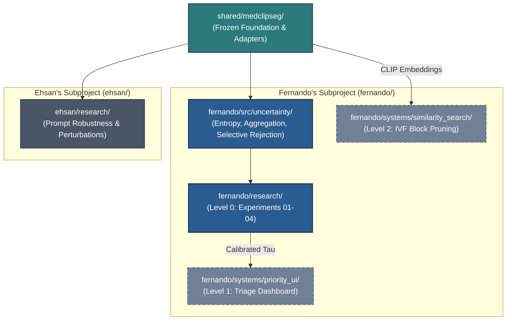
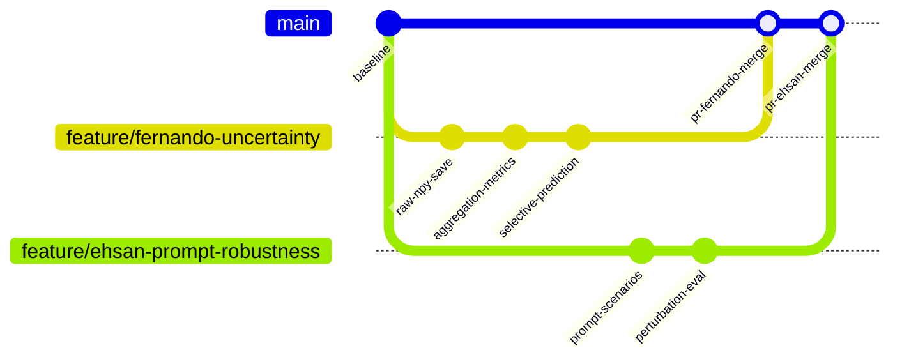
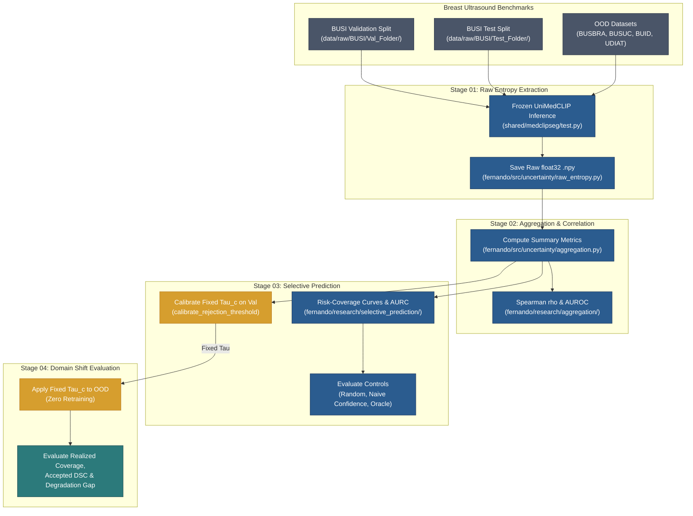
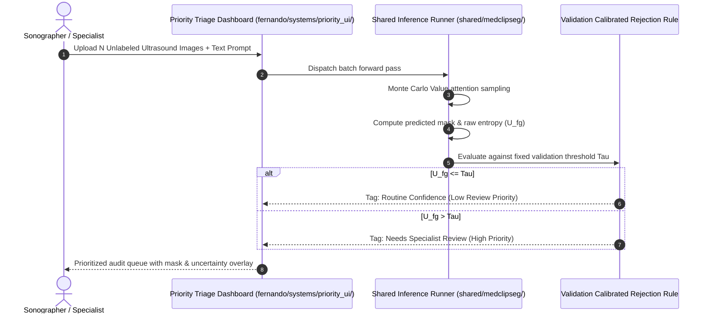
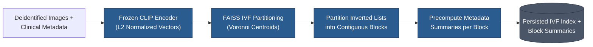

# System Architecture & Technical Specifications

**Course:** ELEC 6661 — Medical Image Processing (Fall 2026), Concordia University\
**Project:** MedCLIPSeg++ Multi-Track Research

---

## 1. Team Ownership & Workstream Architecture

The repository is organized primarily by **research owner** rather than technical layers, providing complete independence for each researcher while anchoring both in a minimal shared baseline:

---

## 2. Development & Branching Workflow

---

## 3. Level 0: Fernando's Scientific Research Pipeline

Level 0 is the mandatory core deliverable of the project. It calibrates selective prediction on In-Distribution validation data and tests its robustness under domain shift without model retraining.

---

## 4. Level 1: Operational Triage & Priority Flow (Fernando)

Level 1 specifies an interactive triage dashboard for new unannotated ultrasound acquisitions where ground truth is not available.

---

## 5. Level 2: Similarity Search & Predicate Pruning (Fernando)

Level 2 decouples vector indexing from online querying, utilizing precomputed block metadata summaries to prune non-matching IVF posting lists during vector distance computation.

### A. Offline Indexing Pipeline

### B. Online Query Pipeline with Within-List Block Pruning

