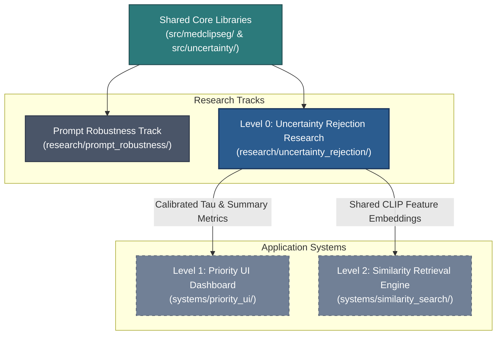
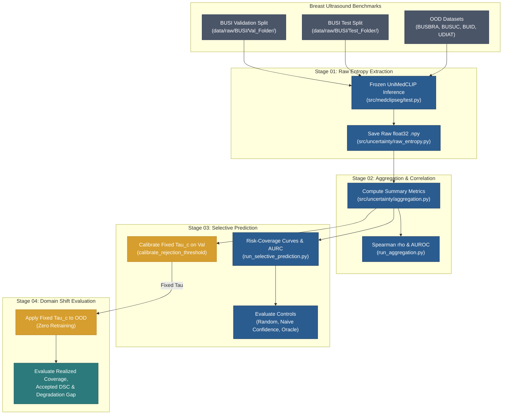
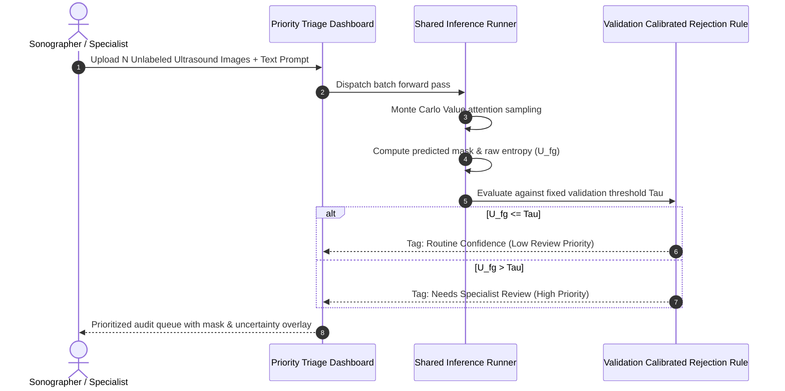
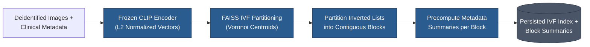
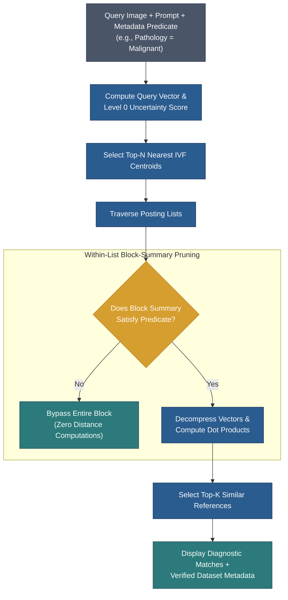

# System Architecture & Technical Specifications

**Course:** ELEC 6661 — Medical Image Processing (Fall 2026), Concordia University\
**Project:** MedCLIPSeg++ Uncertainty-Based Selective Prediction Under Domain Shift

---

## 1. Multi-Track & Multi-Level System Architecture

The repository enforces strict separation between foundational scientific research (Level 0) and optional conceptual systems (Levels 1 and 2), with parallel support for prompt perturbation research:

---

## 2. Level 0: Scientific Research Pipeline

Level 0 is the mandatory core deliverable of the project. It calibrates selective prediction on In-Distribution validation data and tests its robustness under domain shift without model retraining.

---

## 3. Level 1: Operational Triage & Priority Flow

Level 1 specifies an interactive triage dashboard for new unannotated ultrasound acquisitions where ground truth is not available.

---

## 4. Level 2: Similarity Search & Predicate Pruning

Level 2 decouples vector indexing from online querying, utilizing precomputed block metadata summaries to prune non-matching IVF posting lists during vector distance computation.

### A. Offline Indexing Pipeline

### B. Online Query Pipeline with Within-List Block Pruning

