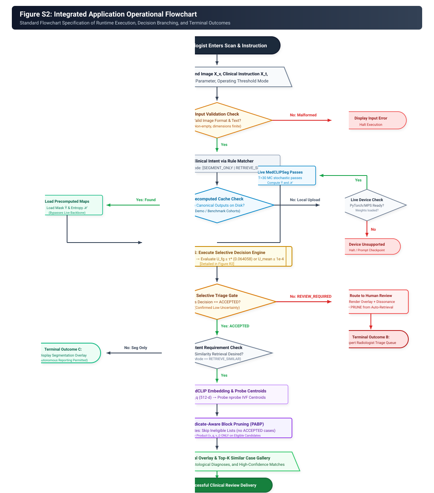

# MedCLIPSeg++: Complete System Architecture and Operational Specification

> **Official Project Name:** MedCLIPSeg++: Reliability-Aware Segmentation and Case Retrieval  
> **Integrated Application:** Uncertainty-Aware Medical Image Retrieval  
> **Scientific Research Component:** Uncertainty-Guided Selective Segmentation  
> **Architecture Level:** L0 System Overview & L1/L2 Modular Hierarchy  
> **Editable Diagram Sources:** [`figures/block_diagram/complete_system_architecture.drawio`](figures/block_diagram/complete_system_architecture.drawio) | [`figures/flowcharts/application_operational_flowchart.drawio`](figures/flowcharts/application_operational_flowchart.drawio)  
> **Vector Exports:** [`figures/block_diagram/complete_system_architecture.svg`](figures/block_diagram/complete_system_architecture.svg) | [`figures/flowcharts/application_operational_flowchart.svg`](figures/flowcharts/application_operational_flowchart.svg) | [`figures/block_diagram/complete_system_architecture.pdf`](figures/block_diagram/complete_system_architecture.pdf) | [`figures/flowcharts/application_operational_flowchart.pdf`](figures/flowcharts/application_operational_flowchart.pdf)

---

## 1. System Overview & Executive Summary

**MedCLIPSeg++** is an open-source clinical research platform that unifies zero-shot medical vision-language segmentation, post-hoc predictive uncertainty quantification, safety-calibrated selective triage, and fast multimodal case retrieval.

The system addresses a critical clinical failure mode in automated radiology: standard deep learning segmentation models produce deterministic binary contours without confidence boundaries, silently outputting plausible-looking false positives on ambiguous acoustic shadows or failing silently under scanner distribution shift.

MedCLIPSeg++ introduces a **hierarchical modular architecture** that connects our scientific research contribution (**Uncertainty-Guided Selective Segmentation**) with an interactive clinical decision-support engine (**Uncertainty-Aware Medical Image Retrieval**). By employing predictive uncertainty as an automated safety guardrail, the system permits similarity retrieval exclusively for high-confidence segmentations while routing ambiguous cases to an expert radiologist queue. Similarity search is accelerated using **Predicate-Aware Block Pruning (PABP)** atop a FAISS-IVF vector index, pruning entire index inverted lists whose candidates fail clinical eligibility criteria.

---

## 2. Complete System Architecture (Figure S1)

Figure S1 depicts the five sequential operational stages of MedCLIPSeg++, mapping user interaction, frozen neural inference, selective triage gating, vector retrieval, and clinical presentation:

```mermaid
flowchart LR
    %% STAGE 1: CLINICAL INTERACTION
    subgraph STAGE_1 ["Stage 1: Clinical Interaction"]
        direction TB
        S1_INPUTS["Clinical Inputs:<br/>• Scan X_v (256x256)<br/>• Instruction X_t<br/>• Top-K Parameter (1-10)<br/>• Threshold Mode"]
        S1_PARSER["Rule-Based Intent Parser<br/>(MOD-INTENT-INTERPRET)<br/>Mode: RETRIEVE_SIMILAR"]
        S1_INPUTS --> S1_PARSER
    end

    %% STAGE 2: SEGMENTATION & UNCERTAINTY BACKBONE
    subgraph STAGE_2 ["Stage 2: Segmentation Backbone (Frozen)"]
        direction TB
        S2_DISPATCH{"Execution Dispatcher:<br/>Disk Cache or Live?"}
        S2_CACHE["A. Precomputed Cache<br/>(Demo / Benchmark Scans)"]
        S2_LIVE["B. Live MedCLIPSeg Backbone<br/>(ViT-B/16 + PVL Adapters)<br/>T=30 MC Stochastic Passes"]
        S2_OUTPUTS["Simultaneous Dual Outputs:<br/>• Predicted Mask Y_hat (0.5 threshold)<br/>• Predictive Entropy Map H in [0, ln 2]"]
        
        S2_DISPATCH -->|"Cached Scan"| S2_CACHE
        S2_DISPATCH -->|"Uploaded Scan"| S2_LIVE
        S2_CACHE --> S2_OUTPUTS
        S2_LIVE --> S2_OUTPUTS
    end

    %% STAGE 3: SELECTIVE DECISION ENGINE
    subgraph STAGE_3 ["Stage 3: Selective Decision Engine (Core Contribution)"]
        direction TB
        S3_STENCIL["Spatial Stencil Operator:<br/>Omega_fg = {(x,y) | Y_hat(x,y) == 1}<br/>(Mask dictates WHERE to measure)"]
        S3_BRANCH{"Foreground Check:<br/>|Omega_fg| > 0 ?"}
        S3_UFG["Branch A: U_fg Evaluation<br/>U_fg = (1/|Omega_fg|) * sum(H)<br/>Is U_fg <= tau* (0.064058) ?"]
        S3_UMEAN["Branch B: Empty Fallback<br/>U_mean = (1/|Omega|) * sum(H)<br/>Is U_mean <= tau_neg (1e-4) ?"]
        S3_ROUTER{"Triage Classification"}
        
        S3_STENCIL --> S3_BRANCH
        S3_BRANCH -->|"Yes: Lesion Present"| S3_UFG
        S3_BRANCH -->|"No: Zero Denom"| S3_UMEAN
        S3_UFG --> S3_ROUTER
        S3_UMEAN --> S3_ROUTER
    end

    %% STAGE 4: SIMILARITY RETRIEVAL & PABP
    subgraph STAGE_4 ["Stage 4: Similarity Retrieval & PABP"]
        direction TB
        S4_GUARD{"Safety Interlock:<br/>Is Status ACCEPTED?"}
        S4_EMBED["Extract 512-d Embedding v_q<br/>(UniMedCLIP Vision Encoder)<br/>L2 Normalization ||v_q||_2 = 1"]
        S4_IVF["FAISS-IVF Index Quantizer:<br/>Probe nprobe Voronoi Centroids"]
        S4_PABP["Predicate-Aware Block Pruning:<br/>Eligible(B) = OR_{j in B} Accepted(j)<br/>Skip Ineligible Lists (No distance calc)"]
        S4_RANK["Inner Product Scorer & Heap:<br/>Rank Top-K Historical Matches"]

        S4_GUARD -->|"Yes: Permitted"| S4_EMBED
        S4_EMBED --> S4_IVF
        S4_IVF --> S4_PABP
        S4_PABP --> S4_RANK
    end

    %% STAGE 5: CLINICAL PRESENTATION
    subgraph STAGE_5 ["Stage 5: Clinical Presentation"]
        direction TB
        S5_OVERLAY["Clinical Tri-Modal Overlay:<br/>Blend(X_v, Y_hat contour, H heatmap)"]
        S5_GALLERY["Top-K Similar Case Gallery:<br/>Historical Scans + Diagnoses + Overlays"]
        S5_REVIEW["Dedicated Human Review Queue:<br/>Flagged Ambiguous Scans Diverted"]
        S5_DISCLAIMER["Research Prototype Notice:<br/>Not for Unsupervised Diagnosis"]
    end

    %% Stage Connections
    STAGE_1 --> STAGE_2
    STAGE_2 --> STAGE_3
    S3_ROUTER -->|"ACCEPTED"| S4_GUARD
    S3_ROUTER -->|"REVIEW REQUIRED"| S5_REVIEW
    S4_RANK --> S5_GALLERY
    STAGE_2 -.-> S5_OVERLAY

    %% Styling
    classDef stageBox fill:#ffffff,stroke:#94a3b8,stroke-width:1.5px;
    classDef s1Style fill:#f8fafc,stroke:#64748b,stroke-width:1.5px;
    classDef s2Style fill:#f0f9ff,stroke:#0284c7,stroke-width:1.5px;
    classDef s3Style fill:#fefce8,stroke:#ca8a04,stroke-width:1.8px;
    classDef s4Style fill:#faf5ff,stroke:#9333ea,stroke-width:1.5px;
    classDef s5Style fill:#f0fdf4,stroke:#16a34a,stroke-width:1.5px;

    class S1_INPUTS,S1_PARSER s1Style;
    class S2_DISPATCH,S2_CACHE,S2_LIVE,S2_OUTPUTS s2Style;
    class S3_STENCIL,S3_BRANCH,S3_UFG,S3_UMEAN,S3_ROUTER s3Style;
    class S4_GUARD,S4_EMBED,S4_IVF,S4_PABP,S4_RANK s4Style;
    class S5_OVERLAY,S5_GALLERY,S5_REVIEW,S5_DISCLAIMER s5Style;
```




---

## 3. Hierarchical Modular Architecture (L0–L3 Breakdown)

MedCLIPSeg++ is structured into interchangeable, loosely coupled functional blocks following standard software modularity:

| Level | Identification | Scientific Designation | Scope of Responsibility |
| :---: | :--- | :--- | :--- |
| **L0** | `SYS-MEDCLIPSEG-PLUS-PLUS` | Complete Clinical System | End-to-end integration of interaction, inference, selective triage, and similarity search. |
| **L1** | `MOD-INTENT-INTERPRET` (L1.1) | Instruction & Intent Parser | Deterministic extraction of user goals, retrieval parameters, and operating modes. |
| **L1** | `MOD-SEG-BACKBONE` (L1.2) | Segmentation & Uncertainty Backbone | Frozen multimodal foundation model producing simultaneous segmentation masks and entropy maps. |
| **L1** | `MOD-SELECTIVE-DECISION` (L1.3) | Selective Decision Engine | Mask-conditioned spatial stencil uncertainty aggregator and calibrated decision threshold gating. |
| **L1** | `MOD-IMAGE-EMBED` (L1.4) | Multimodal Embedding Generator | Dense 512-dimensional visual embedding extraction and L2 unit-sphere projection. |
| **L1** | `MOD-SIMILARITY-RETRIEVAL` (L1.5) | Predicate-Aware Retrieval Engine | Vector similarity search with FAISS-IVF indexing and block-level predicate pruning (PABP). |
| **L1** | `MOD-CLINICAL-PRESENT` (L1.6) | Clinical Presentation & Router | Tri-modal composite visualization, decision badge delivery, and human-review queue routing. |
| **L2** | `SUB-*` Components | Internal Submodules | Functional decomposition of each L1 module into distinct algorithmic tasks (see Section 4). |
| **L3** | Mathematical Operations | Equations & Concrete Logic | Exact mathematical formulations ($\mathcal{H}$, $U_{\mathrm{fg}}$, PABP bitmasks, cosine distance). |

---

## 4. Architectural Module Interface Contracts

Each major functional module adheres to a standardized architectural contract detailing its input/output types, processing invariants, configuration parameters, and operational boundaries:

### Module L1.1: Clinical Instruction & Intent Parser (`MOD-INTENT-INTERPRET`)
- **Module ID:** `MOD-INTENT-INTERPRET`
- **Scientific Name:** Rule-Based Clinical Intent and Parameter Parser
- **Inputs:**
  - Raw natural language prompt string ($X_t \in \text{str}$)
  - User interface configuration state (Streamlit session parameters)
- **Processing Responsibilities:**
  - Applies deterministic regex and keyword matching to identify whether the requested operation is `SEGMENT_ONLY`, `RETRIEVE_SIMILAR`, or `FULL_TRIAGE`.
  - Extracts retrieval depth $K \in [1, 10]$ (default: $K=4$).
  - Validates threshold mode (`frozen_calibrated` vs `manual_override`).
- **Outputs:**
  - Standardized instruction tuple `(intent_mode, top_k, threshold_mode)`
- **Configuration:**
  - Keyword dictionaries for clinical retrieval actions (*"retrieve"*, *"similar"*, *"search"*, *"compare"*, *"reference"*).
- **Dependencies:** None (Standard Python standard library `re`).
- **Limitations:** Does **not** deploy an ungrounded Large Language Model (LLM); parsing is strictly deterministic to prevent clinical hallucination.

### Module L1.2: Probabilistic Segmentation Backbone (`MOD-SEG-BACKBONE`)
- **Module ID:** `MOD-SEG-BACKBONE`
- **Scientific Name:** MedCLIPSeg Probabilistic Vision-Language Segmentation Backbone
- **Inputs:**
  - Preprocessed ultrasound image ($X_v \in \mathbb{R}^{256 \times 256}$, normalized $[0, 1]$)
  - Tokenized text prompt embedding sequence ($Z_t$)
- **Processing Responsibilities:**
  - Executes $T=30$ Monte Carlo forward passes with active dropout ($p=0.20$) and reparameterization sampling ($V_{\mathrm{sample}} = V_\mu + \epsilon \odot V_\sigma$) across bidirectional PVL adapters.
  - Computes mean probability map $\bar{P}(x, y) = \frac{1}{T}\sum_{t=1}^T P_t(x, y)$.
  - Binarizes $\bar{P}$ at threshold $0.50$ to produce predicted mask $\hat{Y}$.
  - Computes dense pixelwise Shannon predictive entropy: $\mathcal{H}(x, y) = -\bar{P}\ln \bar{P} - (1-\bar{P})\ln(1-\bar{P}) \in [0, \ln 2]$.
  - Alternatively, dispatches precomputed canonical outputs directly from disk cache for benchmark cohorts (`BUSI`, `UDIAT`, `BUID`, `BUSUC`, `BUSBRA`).
- **Outputs:**
  - Predicted binary mask $\hat{Y} \in \{0, 1\}^{256 \times 256}$
  - Dense predictive uncertainty map $\mathcal{H} \in [0, \ln 2]^{256 \times 256}$ (float32 numpy array)
- **Configuration:**
  - `mc_samples`: 30
  - `dropout_p`: 0.20
  - `mask_threshold`: 0.50
- **Dependencies:** PyTorch, torchvision, or precomputed `.npy` disk archives.
- **Limitations:** Foundation model weights are strictly frozen; no supervised retraining is performed during deployment.

### Module L1.3: Selective Decision Engine (`MOD-SELECTIVE-DECISION`)
- **Module ID:** `MOD-SELECTIVE-DECISION`
- **Scientific Name:** Mask-Conditioned Uncertainty Triage Supervisor
- **Inputs:**
  - Predicted binary mask $\hat{Y} \in \{0, 1\}^{256 \times 256}$
  - Dense predictive uncertainty map $\mathcal{H} \in [0, \ln 2]^{256 \times 256}$
- **Processing Responsibilities:**
  - Validates finiteness and dimensionality of input arrays.
  - Determines foreground pixel area: count_fg = $|\Omega_{\mathrm{fg}}| = \sum \hat{Y}$.
  - **Foreground Branch ($|\Omega_{\mathrm{fg}}| > 0$):** Computes Foreground Mean Predictive Entropy:
    $$U_{\mathrm{fg}} = \frac{1}{|\Omega_{\mathrm{fg}}|} \sum_{(x,y) \in \Omega_{\mathrm{fg}}} \mathcal{H}(x, y)$$
    Compares $U_{\mathrm{fg}}$ against locked threshold $\tau^* = 0.064058324$.
  - **Empty Mask Branch ($|\Omega_{\mathrm{fg}}| == 0$):** Catches division-by-zero degeneracy; executes negative fallback:
    $$U_{\mathrm{mean}} = \frac{1}{|\Omega|} \sum_{(x,y) \in \Omega} \mathcal{H}(x, y)$$
    Compares $U_{\mathrm{mean}}$ against negative threshold $\tau_{\mathrm{neg}} = 10^{-4}$.
- **Outputs:**
  - Triage decision flag: `ACCEPTED` vs `REVIEW_REQUIRED` (or `ACCEPTED_NEGATIVE` vs `REVIEW_REQUIRED_EMPTY`)
  - Quantitative telemetry dictionary: `{metric_used, score, threshold, coverage_target, realized_cov}`
- **Configuration:**
  - `tau_star`: 0.064058324 (Locked at 80% coverage on BUSI Validation)
  - `tau_neg`: 0.0001 (Quiescent background threshold)
- **Dependencies:** NumPy.
- **Limitations:** Acceptance denotes low predictive model ambiguity, **not** mathematical proof of ground-truth correctness.

### Module L1.4: Multimodal Feature Embedding Generator (`MOD-IMAGE-EMBED`)
- **Module ID:** `MOD-IMAGE-EMBED`
- **Scientific Name:** UniMedCLIP Dense Visual Feature Extractor
- **Inputs:**
  - Normalized ultrasound image ($X_v \in \mathbb{R}^{256 \times 256}$)
- **Processing Responsibilities:**
  - Ingests image into frozen ViT-B/16 visual encoder.
  - Extracts 512-dimensional global visual token representation.
  - Applies L2-normalization: $\hat{v} = v / \|v\|_2$ such that $\|\hat{v}\|_2 = 1.0$.
  - Enables cosine similarity computation via standard Euclidean inner products: $\langle \hat{v}_q, \hat{v}_i \rangle = \cos(\theta)$.
- **Outputs:**
  - Normalized 512-d float32 vector $\hat{v} \in \mathbb{R}^{512}$
- **Configuration:**
  - `embedding_dim`: 512
- **Dependencies:** UniMedCLIP backbone or pre-extracted FAISS gallery tensor.
- **Limitations:** Only visual features are embedded; textual instruction is processed by `MOD-INTENT-INTERPRET` rather than cross-modal projection.

### Module L1.5: Predicate-Aware Similarity Retrieval Engine (`MOD-SIMILARITY-RETRIEVAL`)
- **Module ID:** `MOD-SIMILARITY-RETRIEVAL`
- **Scientific Name:** FAISS-IVF Similarity Search with Predicate-Aware Block Pruning (PABP)
- **Inputs:**
  - Query vector $\hat{v}_q \in \mathbb{R}^{512}$
  - Selective prediction decision status from `MOD-SELECTIVE-DECISION`
  - Gallery IVF Index and PABP Metadata Block Table
- **Processing Responsibilities:**
  - **Safety Interlock:** If query decision status is `REVIEW_REQUIRED`, retrieval is **blocked**; scan is diverted immediately to human review.
  - **Inverted File Probing:** Probes $n_{\mathrm{probe}} = 4$ nearest coarse Voronoi centroids in FAISS-IVF index.
  - **Predicate-Aware Block Pruning (PABP):** For each candidate block $B$ of inverted lists, evaluates the precomputed block predicate summary:
    $$\text{Eligible}(B) = \bigvee_{j \in B} \mathbb{I}\left(\text{Decision}(j) == \text{ACCEPTED}\right)$$
    If $\text{Eligible}(B) == \text{False}$, the entire block is **pruned**, completely skipping vector distance computations.
  - **Top-K Ranking:** Computes inner products only on verified eligible items; maintains min-heap of size $K$.
- **Outputs:**
  - Top-$K$ retrieved neighbor list: `[{case_id, similarity_score, metadata, thumbnail_path}]`
- **Configuration:**
  - `nprobe`: 4
  - `pabp_block_size`: 64
- **Dependencies:** FAISS, NumPy.
- **Limitations:** Only cases pre-indexed with valid triage metadata can be pruned at the block level.

### Module L1.6: Clinical Presentation & Router (`MOD-CLINICAL-PRESENT`)
- **Module ID:** `MOD-CLINICAL-PRESENT`
- **Scientific Name:** Tri-Modal Composite Visualizer and Clinical Queue Router
- **Inputs:**
  - Raw ultrasound scan ($X_v$)
  - Predicted mask ($\hat{Y}$)
  - Uncertainty map ($\mathcal{H}$)
  - Selective decision flag & telemetry
  - Top-$K$ retrieval matches (if retrieved)
- **Processing Responsibilities:**
  - Renders interactive tri-modal composite overlay:
    $$I^{**} = \alpha \cdot \text{Colormap}(\mathcal{H}) + (1-\alpha) \cdot X_v + \text{Contour}(\hat{Y})$$
  - Renders clinical status banner (`ACCEPTED: High Confidence` vs `REVIEW REQUIRED: Borderline Ambiguity`).
  - Displays Top-$K$ retrieved historical matches with ground-truth diagnoses and similarity scores.
  - Routes flagged scans to dedicated Review-Required gallery.
  - Displays prominent research prototype disclaimer.
- **Outputs:**
  - Interactive Streamlit DOM rendering
- **Configuration:**
  - `alpha_default`: 0.40
  - `contour_color`: Green (`#16a34a`)
  - `colormap`: Turbo / Jet
- **Dependencies:** Streamlit, OpenCV (`cv2`), Matplotlib (colormaps).
- **Limitations:** Visualizations are intended strictly for clinical research review, not automated diagnostic sign-off.

---

## 5. Application Operational Flowchart (Figure S2)

Figure S2 depicts the software control flow, decision diamonds, exception paths, and terminal outcomes executed during runtime:



```mermaid
flowchart TD
    %% START & INPUT
    T_START([Start: Radiologist Enters Scan & Instruction]) --> P_INPUT[/Input: Ultrasound Image X_v, Clinical Instruction X_t,<br/>Top-K Parameter, Operating Threshold Mode/]

    %% DECISION 1: VALIDATION
    P_INPUT --> D_VAL{"Input Validation Check:<br/>Valid Image Format & Dimensions?<br/>(Non-empty, finite values)"}
    
    D_VAL -->|"No: Malformed"| T_ERR1([Terminal Outcome E:<br/>Display Input Error & Halt])
    D_VAL -->|"Yes: Valid"| P_INTENT[Parse Clinical Intent via Rule Matcher<br/>Extract Top-K & Mode: SEGMENT_ONLY or RETRIEVE_SIMILAR]

    %% DECISION 2: CACHE CHECK
    P_INTENT --> D_CACHE{"Precomputed Cache Check:<br/>Are Canonical Outputs on Disk?<br/>(Demo / Benchmark Cohorts)"}

    D_CACHE -->|"Yes: Found"| P_LOAD_CACHE[Load Precomputed Maps from Disk:<br/>Mask Y_hat and Predictive Entropy H<br/>(Bypasses Live Backbone)]
    D_CACHE -->|"No: Uploaded"| D_DEVICE{"Live Device Check:<br/>PyTorch / MPS GPU Ready?<br/>Model Weights Loaded?"}

    D_DEVICE -->|"No: Unsupported"| T_ERR2([Terminal Outcome F:<br/>Display Device Error & Halt])
    D_DEVICE -->|"Yes: Supported"| P_LIVE[Execute Frozen MedCLIPSeg Backbone:<br/>T=30 Stochastic Monte Carlo Passes<br/>Compute Y_hat and H]

    %% SUBPROCESS: SELECTIVE DECISION
    P_LOAD_CACHE --> SUB_SELECT[[Execute Selective Decision Engine<br/>Detailed in Figure R2:<br/>Apply Spatial Stencil Omega_fg -> Evaluate U_fg <= tau* or U_mean <= tau_neg]]
    P_LIVE --> SUB_SELECT

    %% DECISION 3: SELECTIVE TRIAGE
    SUB_SELECT --> D_TRIAGE{"Selective Triage Gate:<br/>Is Decision == ACCEPTED?<br/>(Confirmed Low Uncertainty)"}

    %% BRANCH: REVIEW REQUIRED
    D_TRIAGE -->|"No: REVIEW_REQUIRED"| P_ROUTE_REVIEW[Route to Dedicated Human Review Queue:<br/>• Render Tri-Modal Overlay with Dissonance<br/>• PRUNE Scan from Automatic Retrieval]
    P_ROUTE_REVIEW --> T_OUT_B([Terminal Outcome B:<br/>Expert Radiologist Review Queue])

    %% BRANCH: ACCEPTED
    D_TRIAGE -->|"Yes: ACCEPTED"| D_RET_DESIRED{"Intent Requirement Check:<br/>Is Similarity Retrieval Desired?<br/>(Mode == RETRIEVE_SIMILAR)"}

    D_RET_DESIRED -->|"No: Seg Only"| T_OUT_C([Terminal Outcome C:<br/>Display Segmentation Overlay Only<br/>Autonomous Reporting Permitted])

    %% RETRIEVAL PIPELINE
    D_RET_DESIRED -->|"Yes: Retrieve"| P_EMBED[Extract UniMedCLIP Embedding & Probe Centroids:<br/>L2-normalize v_q (512-d) -> Probe nprobe IVF Centroids]
    P_EMBED --> P_PABP[Evaluate Predicate-Aware Block Pruning:<br/>Evaluate Block Predicates: Skip Ineligible Lists<br/>Compute Inner Product ONLY on Verified Candidates]

    P_PABP --> D_MATCHES{"Candidate Check:<br/>Were Top-K Matches Found?"}

    D_MATCHES -->|"No Matches"| T_OUT_D([Terminal Outcome D:<br/>Display Overlay + Warning:<br/>No Eligible Cases in Gallery])
    D_MATCHES -->|"Yes: Matches Found"| P_DELIVER[/Deliver Tri-Modal Overlay & Top-K Similar Gallery:<br/>Present Query Overlay, Histological Diagnoses,<br/>and High-Confidence Reference Cases/]

    P_DELIVER --> T_OUT_A([Terminal Outcome A:<br/>End: Successful Clinical Review Delivery])

    %% Styling
    classDef startEnd fill:#1e293b,stroke:#0f172a,stroke-width:2px,color:#ffffff;
    classDef decision fill:#fffbeb,stroke:#d97706,stroke-width:2px,color:#78350f;
    classDef process fill:#f1f5f9,stroke:#94a3b8,stroke-width:1.5px,color:#0f172a;
    classDef ioNode fill:#f8fafc,stroke:#64748b,stroke-width:1.5px,color:#0f172a;
    classDef subproc fill:#fefce8,stroke:#ca8a04,stroke-width:2px,color:#854d0e;
    classDef acceptOut fill:#dcfce7,stroke:#16a34a,stroke-width:2px,color:#15803d;
    classDef rejectOut fill:#fee2e2,stroke:#ef4444,stroke-width:2px,color:#991b1b;

    class T_START,T_OUT_A,T_OUT_C startEnd;
    class T_ERR1,T_ERR2,T_OUT_B,T_OUT_D rejectOut;
    class D_VAL,D_CACHE,D_DEVICE,D_TRIAGE,D_RET_DESIRED,D_MATCHES decision;
    class P_INTENT,P_LOAD_CACHE,P_LIVE,P_ROUTE_REVIEW,P_EMBED,P_PABP process;
    class P_INPUT,P_DELIVER ioNode;
    class SUB_SELECT subproc;
```

---

## 6. Architectural Extensibility & Future Substitutions

The modular design allows future researchers to substitute individual functional blocks without re-architecting the system:

| Architectural Component | Current Implementation | Validated Interface Contract | Proposed Future Substitution (Architectural Possibility) |
| :--- | :--- | :--- | :--- |
| **Segmentation Backbone** | MedCLIPSeg (ViT-B/16 + PVL) | Consumes $X_v, X_t$; produces $\hat{Y} \in \{0, 1\}^{H \times W}, \mathcal{H} \in \mathbb{R}^{H \times W}$ | Replace with BioMedCLIPSeg, SAM-Med2D, or SwinUNETR with test-time dropout. |
| **Uncertainty Aggregation** | $U_{\mathrm{fg}}$ (Foreground Mean Entropy) | Consumes $\hat{Y}, \mathcal{H}$; produces scalar score $U \in \mathbb{R}^+$ | Substitute with epistemic ensemble variance, evidential deep learning, or boundary surface dissonance. |
| **Selective Decision Policy** | Calibrated threshold $\tau^* = 0.064058$ | Consumes $U$; produces `{ACCEPTED, REVIEW_REQUIRED}` | Substitute with conformal prediction risk sets guaranteeing user-specified false discovery bounds ($1-\alpha$). |
| **Embedding Engine** | UniMedCLIP (512-d visual) | Consumes $X_v$; produces unit vector $\hat{v} \in \mathbb{R}^{512}$ | Substitute with pathology-specific multimodal contrastive embeddings (e.g. RadImageNet, CONCH). |
| **Retrieval & Pruning Backend** | FAISS-IVF + PABP Bitmasks | Consumes $\hat{v}_q$, predicate $\mathbb{I}$; produces Top-$K$ | Scale to Milvus, Qdrant, or HNSW graph indexing with predicate-aware pre-filtering. |

> [!IMPORTANT]
> The substitutions listed above represent **future architectural capabilities enabled by our modular design**, not claims that alternative models have already been implemented or validated in the current codebase.

---

## 7. Clinical Safety Invariants & Limitations

1. **Safety Interlock Guarantee:** No ultrasound scan with an ambiguous segmentation ($U_{\mathrm{fg}} > \tau^*$) is ever permitted to query the similarity search database automatically. This prevents hallucinated or mislocalized lesion features from retrieving misleading reference cases.
2. **Offline Benchmarking Decoupling:** Ground-truth masks ($Y$) and quantitative evaluation metrics (Dice, NSD) are strictly absent during live deployment. Triage operates exclusively as a post-hoc function of the model's internal predictive entropy.
3. **Empty Mask Integrity:** In screening populations, an empty predicted mask ($|\Omega_{\mathrm{fg}}| = 0$) triggers the quiescent field check ($U_{\mathrm{mean}} \le 10^{-4}$), ensuring that diffuse acoustic abnormalities without focal boundaries are safely routed to clinical review rather than silently accepted as normal.
4. **Research Prototype Notice:** MedCLIPSeg++ is an open-source clinical research platform designed to study reliability and selective triage under domain shift. It is **not** an FDA-cleared diagnostic device and must not be used for unsupervised clinical decision-making.

