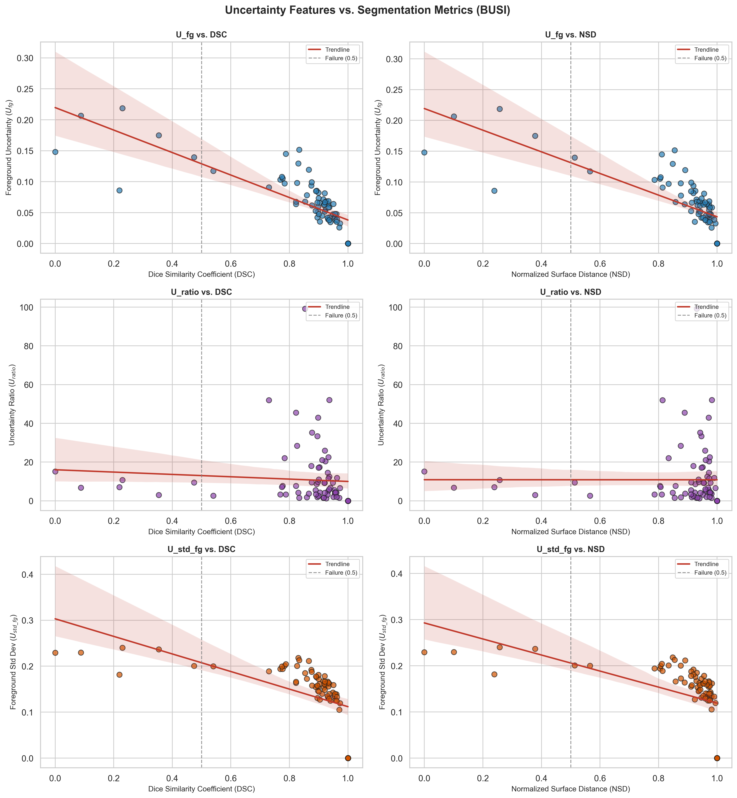

# MedCLIPSeg++: Uncertainty-Based Selective Prediction Under Domain Shift

**Course:** ELEC 6661 — Medical Image Processing (Fall 2026), Concordia University
**Project Tracks:** Uncertainty & Selective Prediction Track, Prompt Robustness Track
**Supervision:** IMPACT Lab (Prof. Hassan Rivaz, Omid Nejati Manzari)

---

## 1. Problem & Motivation

Automated medical image segmentation using deep neural networks offers tremendous clinical promise. However, when deployed in hospital environments, models encounter **domain shift** caused by differences in scanner manufacturers, probe frequencies, acquisition protocols, and patient cohorts. Under domain shift, models frequently make confident errors without alerting the clinician.

MedCLIPSeg introduces probabilistic vision-language adapters with Monte Carlo variational attention, producing dense pixel-level uncertainty maps. However, it is unknown whether these uncertainty maps remain reliable under domain shift, and whether they can support a post-hoc **selective prediction rule** to abstain from autonomous decisions on uncertain cases.

---

## 2. Baseline Architecture (MedCLIPSeg)

We evaluate against the official released weights of [MedCLIPSeg](https://github.com/HealthX-Lab/MedCLIPSeg) (CVPR 2026, Koleilat et al.):
- **Vision-Language Foundation Backbone:** Frozen `UniMedCLIP ViT-B/16`.
- **Probabilistic Adapters:** Variational Key/Value attention projecting multi-scale visual tokens to latent Gaussian distributions.
- **Uncertainty Quantification:** Monte Carlo sampling of Value features generating predictive mean segmentations and pixel-level binary entropy maps.

---

## 3. Our Contribution: Selective Prediction Without Retraining

We propose a post-hoc **Uncertainty-Based Selective Prediction** framework requiring **zero model retraining**:
1. **Raw Feature Aggregation:** Extract uncompressed, raw float32 pixel entropy arrays and summarize into lesion-focused metrics ($U_{\text{fg}}, U_{\text{std\_fg}}, U_{\text{boundary}}$).
2. **Strict Validation Calibration:** Calibrate deployable rejection thresholds ($\tau_c$) strictly on the In-Distribution (BUSI) validation split.
3. **Selective Abstention:** Automatically route images with $U > \tau_c$ to expert sonographer review, retaining predictions with $U \le \tau_c$.
4. **Domain Shift Evaluation:** Apply the frozen model and frozen $\tau_c$ across unseen datasets (BUSBRA, BUSUC, BUID, UDIAT).

---

## 4. Datasets & Evaluation Metrics

- **In-Distribution (ID):** BUSI (Breast Ultrasound Images Dataset).
- **Out-Of-Distribution (OOD):** BUSBRA, BUSUC, BUID, UDIAT.
- **Metrics:**
  - Dice Similarity Coefficient (DSC) and Normalized Surface Distance (NSD).
  - Spearman Rank Correlation ($\rho$) between uncertainty and segmentation error.
  - Failure AUROC ($\text{DSC} < 0.5$).
  - Area Under the Risk-Coverage Curve (AURC).

---

## 5. Quantitative Results (BUSI Test Set)

### Summary Metrics
- **Strongest Error Predictor:** Foreground Standard Deviation $U_{\text{std\_fg}}$ achieves $\rho = -0.9022$ ($p = 1.80 \times 10^{-29}$) with DSC.
- **Failure Discrimination:** Foreground mean uncertainty $U_{\text{fg}}$ achieves an AUROC of **0.9630** for identifying segmentations with $\text{DSC} < 0.5$.
- **Selective Retention Gain:** At 90% coverage, uncertainty rejection raises mean DSC from $0.8572$ to **$0.9038$** (vs. random rejection DSC $0.8573$).
- **Selective Efficiency:** Realizes an Area Under Risk-Coverage Curve (AURC) of **0.0464**.

---

## 6. Reproducibility & Code

All code, configurations, and evaluation scripts are available in the public repository:
[GitHub Repository](https://github.com/Fergarciamedina/MedCLIPSeg-plus-plus)
