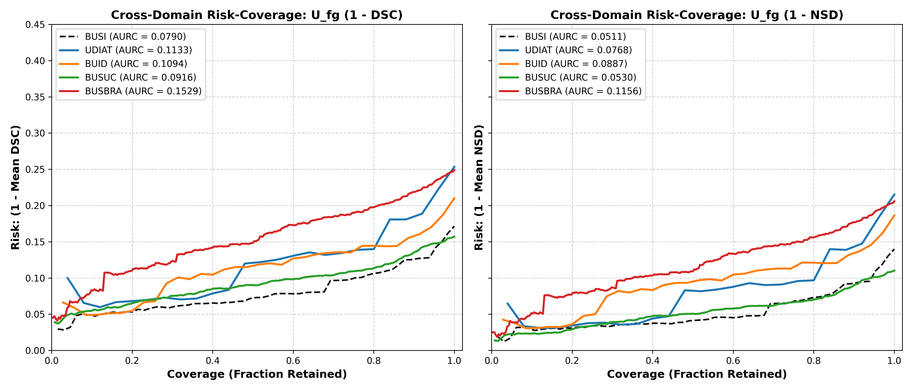

# Stage 4 results

Location `research/stage_4_selective_prediction/experiments/` · [Up to stage_4_selective_prediction/](../SELECTIVE_PREDICTION_STUDY.md)

Can a scan-level uncertainty score rank segmentation failures? The saved analyses compare seven scores on BUSI validation, then apply one fixed rule to a separate BUSI test split and four external breast ultrasound cohorts.

| Phase folder | Contents |
| --- | --- |
| [prepare_uncertainty_scores/](prepare_uncertainty_scores/PREPARE_UNCERTAINTY_SCORES.md) | Converts saved masks, entropy and quality measurements into the scores used in the study. |
| [validation_selection/](validation_selection/VALIDATION_SELECTION.md) | Compares scores on BUSI validation and freezes the policy. [Validation artifacts](validation_selection/results/VALIDATION_RESULTS.md). |
| [locked_busi_test/](locked_busi_test/LOCKED_BUSI_TEST.md) | Tests the frozen rule on held-out BUSI. [Held-out artifacts](locked_busi_test/results/LOCKED_BUSI_RESULTS.md). |
| [external_test/](external_test/EXTERNAL_TEST.md) | Measures transfer to four external cohorts. [Cross-domain and cohort artifacts](external_test/results/CROSS_DOMAIN_RESULTS.md). |

## What to look at

| Question | Start here |
| --- | --- |
| How was the score chosen? | [Seven-method comparison](validation_selection/results/validation_method_comparison_N65.csv), [paired bootstrap](validation_selection/results/paired_bootstrap_aurc_ci.csv), and [validation risk–coverage curves](validation_selection/results/figure1_risk_coverage_curves.png). |
| What rule was carried forward? | [Frozen policy YAML](validation_selection/frozen_selective_prediction_config.yaml) and [validation operating points](validation_selection/results/calibrated_abstention_thresholds.csv). |
| What happened on held-out BUSI? | [Primary operating point](locked_busi_test/results/primary_operating_point_test.csv), [comparison of methods](locked_busi_test/results/method_comparison_test_n65.csv), [pathology subgroups](locked_busi_test/results/subgroup_pathology_breakdown_test.csv), and [empty-mask policies](locked_busi_test/results/setting_b_deployment_policies_test.csv). |
| How did the rule transfer? | [Cross-domain summary](external_test/results/cross_domain_summary.csv) and [risk–coverage curves](external_test/results/cross_domain_risk_coverage_overlay.png). Individual results are available for [UDIAT](external_test/results/UDIAT/UDIAT_RESULTS.md), [BUID](external_test/results/BUID/BUID_RESULTS.md), [BUSUC](external_test/results/BUSUC/BUSUC_RESULTS.md), and [BUSBRA](external_test/results/BUSBRA/BUSBRA_RESULTS.md). |

## How to read the numbers

**Coverage** is the fraction of cases retained by the rule. **Dice** compares the predicted mask to its reference. A gain in mean Dice for retained cases describes the quality of the selected subset at its reported coverage. **AURC** is the area under the empirical risk–coverage curve. Lower values indicate better ranking at the coverage levels used in the comparison. The pooled external summary weights each image equally. The macro average weights each of the four external cohorts equally. [Metric definitions](../study_reference/THEORY_AND_METRICS.md).

## How to read the frozen YAML

The [YAML](validation_selection/frozen_selective_prediction_config.yaml) and [JSON](validation_selection/frozen_selective_prediction_config.json) are archived experiment outputs. The test runners read the numeric YAML from the local experiment output tree. The archived copies are kept with validation selection for inspection and reuse.

| Section | Meaning |
| --- | --- |
| `metadata` | Validation cohort, seed and denominators used for calibration. |
| `primary_method` and `prespecified_comparator` | The selected foreground mean and the foreground dispersion comparator. |
| `primary_operating_point` | The designated validation target `coverage_80`. For a nonempty predicted mask, retain the prediction if `U_fg ≤ 0.064058324` nats. |
| `empty_mask_deployment_policies` | Under Setting A, empty predicted masks are excluded from the main lesion-score analysis. Under Setting B, the separate empty-mask branch uses `U_mean ≤ 0.0001` nats. |
| `calibrated_abstention_thresholds_setting_A` | The other nominal targets, the cutoffs fitted on validation, and their realized validation coverage. |

For the statistical comparison of foreground mean versus dispersion, use the [paired-bootstrap CSV](validation_selection/results/paired_bootstrap_aurc_ci.csv). Its interval and p-value differ from the historical prose fields in the archived configuration. The retained-case rule comes from the numeric policy fields. [Reconciliation and experimental rationale](../study_reference/EXPERIMENTAL_RATIONALE.md#aggregation-metrics-and-operating-policy).

The [benchmarking notebook](../../notebooks/02_scientific_benchmarking.ipynb) reads these aggregate tables and figures. The [reproduction guide](../SELECTIVE_PREDICTION_STUDY.md#reproduction) explains how to regenerate the results from locally prepared artifacts.
